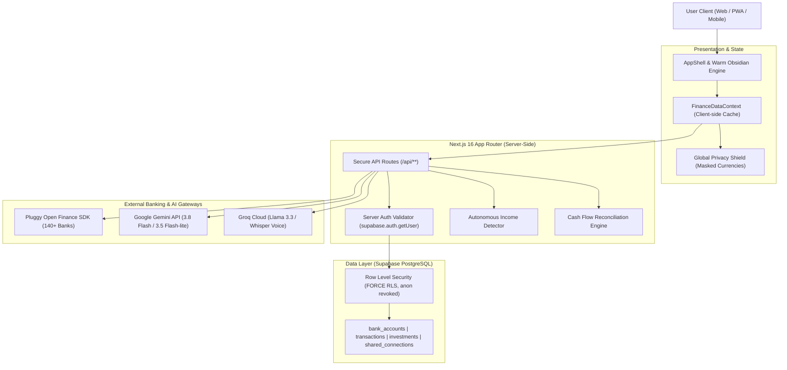

<p align="center">
  
</p>

<h1 align="center">Kitsune Finance</h1>

<p align="center">
  <strong>Autonomous Wealth Management, Open Finance Consolidation, and Private Family Office Engine</strong>
</p>

<p align="center">
  <a href="https://nextjs.org"></a>
  <a href="https://react.dev"></a>
  <a href="https://www.typescriptlang.org"></a>
  <a href="https://tailwindcss.com"></a>
  <a href="https://supabase.com"></a>
  <a href="https://pluggy.ai"></a>
  <a href="./LICENSE"></a>
</p>

<p align="center">
  <a href="#overview">Overview</a> &bull;
  <a href="#the-zero-cost-sovereignty-model">Zero-Cost Model</a> &bull;
  <a href="#system-architecture">Architecture</a> &bull;
  <a href="#core-capabilities">Core Capabilities</a> &bull;
  <a href="#interface-showcase--visual-tour">Interface Showcase</a> &bull;
  <a href="#security-and-data-protection">Security</a> &bull;
  <a href="#tech-stack">Tech Stack</a> &bull;
  <a href="#getting-started">Getting Started</a> &bull;
  <a href="#environment-variables">Configuration</a> &bull;
  <a href="#license">License</a>
</p>

---

## Overview

Kitsune Finance is a production-grade, self-hostable wealth management platform and digital family office. It eliminates reliance on expensive proprietary financial SaaS products, third-party data brokers, and closed banking aggregators.

By marrying Brazil's Open Finance ecosystem with local mathematical reconciliation and an orchestrated multi-model AI pipeline, Kitsune delivers sovereign financial intelligence: real-time multi-bank aggregation, credit card installment forecasting, macroeconomic investment benchmarks, and multi-member family balance sheets at zero recurring infrastructure cost.

### The Mission: Sovereign Finance Without Recurring Subscriptions

Traditional personal finance applications suffer from three critical structural flaws:
1. **Aggressive Pricing:** Proprietary aggregators (e.g., Copilot, Monarch, Lunch Money) demand monthly or annual subscription fees of $10 to $25 per month, plus corporate data sync costs that easily surpass $500/year.
2. **Data Monetization:** Free aggregators often subsidize operations by selling anonymized transactional telemetry, credit profiles, and purchasing habits to financial institutions and ad networks.
3. **AI Hallucinations:** Generic AI wrappers ask Large Language Models to calculate net worth, arithmetic sums, and debt interest directly, resulting in fabricated numbers and dangerous financial advice.

Kitsune Finance solves all three challenges. It runs entirely on generous, permanently free developer tiers (Supabase PostgreSQL, Pluggy Open Finance Sandbox/Personal, Google Gemini Free Tier, Groq Cloud, Vercel/Self-hosted Node.js). You own the database, the keys, and the code.

---

## The Zero-Cost Sovereignty Model

Kitsune Finance is engineered to deliver enterprise-grade wealth infrastructure with an operational balance of exactly $0.00/month.

| Infrastructure Layer | Technology Used | Deployment Model | Cost |
| :--- | :--- | :--- | :--- |
| Database & Security | Supabase (PostgreSQL 15+) | Free Tier (500MB DB, 50k MAU, Row Level Security) | $0.00 |
| Identity & Authentication | Supabase Auth (Google OAuth2 + SSR) | Free Tier (Unlimited Social Providers) | $0.00 |
| Open Finance Pipeline | Pluggy SDK (`pluggy-sdk`) | Developer Tier (Personal Connections Sandbox/Live) | $0.00 |
| Primary AI Reasoning | Google Gemini API (`gemini-3.8-flash`, `gemini-3.5-flash-lite`) | Google AI Studio Free Tier (15 RPM / 1M TPM) | $0.00 |
| Fast AI Inference & Audio | Groq Cloud (`llama-3.3-70b-versatile`, `whisper-large-v3`) | Free Cloud Tier (High TPS, Ultra-Low Latency) | $0.00 |
| Application Hosting | Vercel Hobby or Self-Hosted Docker | Free Tier / Self-Hosted VPS / Home Server | $0.00 |
| Vector Engine (Semantic) | Supabase `pgvector` extension | Native PostgreSQL extension (Vector 1536) | $0.00 |

Total estimated operating cost: **$0.00 per month**.

---

## System Architecture

Kitsune Finance decouples mathematical execution from natural language understanding through an architecture known as MSLR (Multi-Step Logical Reasoning).



### The Deterministic MSLR Pattern

Large Language Models are non-deterministic and prone to arithmetic failure. Kitsune Finance resolves this by enforcing a strict division of labor:
1. **Parameter & Intent Extraction:** Groq (`llama-3.3-70b-versatile`) parses natural language inputs and extracts operational bounds (dates, merchant names, categories, intent targets) in sub-100ms latency.
2. **Deterministic Computation:** Strict TypeScript algorithms query PostgreSQL through Supabase RLS. All math (balances, net worth, cash flow, debt burn rate, interest projections, compound interest) is calculated purely in code.
3. **Synthesis & Persona Delivery:** The immutable computed JSON is passed to the Google Gemini model pool (`gemini-3.8-flash` or `gemini-3.5-flash-lite`). The LLM acts solely as a financial communicator and synthesizer, rendering the pre-calculated numbers into clear, actionable advice without ever modifying the underlying figures.

---

## Core Capabilities

### 1. Open Finance Brazil Integration
* **Multi-Bank Sync:** Integrated with Pluggy SDK supporting over 140 Brazilian banks, fintechs, and credit cooperatives (Nubank, Itaú, Bradesco, Santander, Banco do Brasil, Inter, BTG Pactual, C6 Bank, XP, Sicoob, Sicredi, Civia, Unicred, Ailos, Cresol, and others).
* **Multi-Tier SVG Brand Resolver:** Intelligent three-tier logo architecture (`BankLogo.tsx`):
  1. Handcrafted, high-fidelity SVGs for top 16 national institutions.
  2. Dynamic CDN lookup covering 140+ official Open Finance homologated banks.
  3. Clean neutral SVG fallback (`generic.svg`).
* **Consolidated Identity:** Multi-bank consensus engine merging KYC data into a unified profile with masked tax identification (CPF).

### 2. Credit Card Wallet & Installments Engine (`/cards`)
* **Apple Wallet Master-Detail Architecture:** Split layout for desktop with stacked vertical cards on the left and active card analytics on the right. Smooth 2-touch interaction (preview and select) with relevance sorting.
* **Touch & Drag Carousel:** Interactive mouse-drag (`cursor-grab`) and touch-swipe card carousel with real-time limit utilization indicators.
* **Dynamic Card Theme Resolver:** Automatically applies custom visual styling, textures, and specular reflections based on card tier (Black, Ultravioleta, Uniclass, Azul Itaú, C6 Carbon, Inter Platinum).
* **Installment Breakdown:** Dedicated tracker detailing active installment plans (current installment, remaining balance, monthly commitment, and completion dates).
* **Tariff & Annual Fee Auditing:** Identifies recurring membership charges and maintenance fees across accounts.

### 3. Investment Portfolio & Macroeconomic Radar (`/investments`)
* **Comprehensive Asset Tracking:** Consolidates Fixed Income (CDB, LCI, LCA, CRI, CRA), Equities (B3 stocks, FIIs), Treasury Direct (Tesouro Direto), and Mutual Funds.
* **Macroeconomic Gauges:** Real-time Brazilian economic barometer tracking Selic, CDI, IPCA inflation, Real Interest Rate spread, Ibovespa index, and USD exchange rate.
* **Yield Projections:** Cumulative return tracking and projected monthly yield relative to 100% CDI benchmarks.
* **Audit & Pagination:** Clear segregation between high-volume core assets and micro-allocations, with paginated position tables and historical zero-balance archive toggles.

### 4. 360-Degree Shared Space / Digital Family Office (`/shared`)
* **Multi-Member Governance:** Centralized hub for couples, families, and business partners with customizable roles (Spouse, Family Member, Dependent, Partner, Financial Associate).
* **Consolidated vs. Individual Views:** Joint net worth and combined cash flow overview, coupled with isolated tabs per member to inspect individual accounts and credit statements.
* **Fair-Share Split Calculator:** Automatically calculates financial division using both 50/50 equal distribution and income-proportional ratios, outputting exact reimbursement figures.
* **Paid & Pending Obligations:** Shared bill tracker detailing dueDate, payment status, and responsible member.
* **Compound Interest Goal Simulator:** Interactive family objective planner simulating joint savings trajectories over 1 to 30 years.
* **One-Click Invitations:** Instant invitation delivery via WhatsApp, Gmail, direct links (`?accept_invite=...`), and human-readable codes (`KT-XXXX`).
* **Instant Disconnect:** Single-click departure button with immediate Supabase RLS revocation, leaving zero shared footprint.

### 5. Cash Flow & Mathematical Precision
* **Internal Transfer Reconciliation:** Transfers between accounts owned by the same user or within the household are tagged with `is_internal_transfer = true`, preventing artificial revenue or expense inflation.
* **Credit Card Refund Netting:** Refunded transactions (`is_refund = true`) automatically offset expenses rather than registering as anomalous income.
* **Autonomous Income Detector:** Algorithm (`income-detector.ts`) analyzing deposit frequencies, standard deviations, and calendar dates to classify cash flow into CLT/Regular Salary, Freelance/Variable Income, or Sporadic Transfers, cross-referencing against declared income to alert for discrepancies.
* **Timezone Offset Correction:** Local date parsing (`parseLocalDate`) preventing UTC displacement on the first day of each month, ensuring proper allocation of salary and bills.

### 6. Kitsune AI Financial Advisor (`/kitsune`)
* **Multi-LLM Failover Pool:** Cascade routing through Google Gemini API (`gemini-3.8-flash`, `gemini-3.5-flash-lite`, `gemini-3.1-pro-preview`) and Groq (`llama-3.3-70b-versatile`).
* **Four-Stage Reasoning Pacing:** Visual feedback pipeline showing live operational states: Connecting -> Reconciling -> Auditing -> Formulating.
* **Voice Input with Live Audio Waveforms:** Real-time Web Audio API frequency analysis coupled with Groq Whisper (`whisper-large-v3`) transcription.
* **Vision & Multimodal Receipt OCR:** WebRTC camera capture and gallery uploads with client-side canvas compression for rapid parsing of receipts, restaurant bills, and impulsive purchase evaluations.
* **Session Context Caching:** Persistent chat sessions in `ai_chat_sessions` and `ai_chat_messages`. User financial dossiers are built once per session and invalidated only upon new Open Finance synchronizations.

### 7. Global Search, Analytics & Privacy
* **Global Finance Search (`Ctrl+K`):** Instant search modal querying across all accounts, merchants, categories, and historical notes with merchant profile dossiers and Simple Icons brand resolution.
* **Visual Analytics Suite:** Spending curve trajectory comparisons, category donut charts, daily activity heatmaps, and recurring subscription forecasts.
* **Global Privacy Mode:** One-click toggle masking all monetary figures to `R$ ••••••` across dashboards, charts, tables, and AI cards. Enabled by default (`isPrivacyMode = true`).
* **Automated Data Export:** Instant generation and download of structured financial reports and spreadsheets (`/api/export/spreadsheet`).

---

## Interface Showcase & Visual Tour

Kitsune Finance pairs raw mathematical precision with an elite Warm Obsidian design aesthetic. Below is a structured tour of the core interfaces.

### 1. Unified Wealth Dashboard
The nerve center of personal finance. Consolidates multi-bank liquidity, historical spending curves, daily cash burn rates, recent transactions, and macro KPIs.
<p align="center">
  
</p>

### 2. Apple Wallet Cards Stack (`/cards`)
A master-detail card wallet featuring dynamic card skins, interactive mouse-drag and touch carousels, limit utilization meters, upcoming invoices, and installment breakdowns.
<p align="center">
  
</p>

### 3. Investment Portfolio & Macroeconomic Radar (`/investments`)
Tracks Fixed Income (CDBs, LCIs), Treasury Direct, and Equities against real-time Brazilian benchmarks (Selic, CDI, IPCA inflation, Real Interest Rate spread, Ibovespa, USD).
<p align="center">
  
</p>

### 4. 360-Degree Shared Space / Family Office (`/shared`)
The household financial command center. Features joint net worth consolidation, individual member tabs, an automated fair-share split calculator (50/50 and income-proportional), and compound interest goal simulation.
<p align="center">
  
</p>

### 5. Kitsune AI Autonomous Advisor (`/kitsune`)
Multi-model reasoning advisor with live 4-stage thought pacing (Connecting, Reconciling, Auditing, Formulating), live Web Audio frequency waveforms, Whisper voice input, and receipt OCR analysis.
<p align="center">
  
</p>

### 6. Global Finance Search (`Ctrl+K`)
Instant search across all accounts, merchants, and notes, featuring automated brand resolution with Simple Icons and deep merchant spending dossiers.
<p align="center">
  
</p>

---

## Security and Data Protection

Security is enforced at the database and server layers, ensuring protection against client tampering and prompt injection vulnerabilities.

```
+-------------------------------------------------------------------+
|                        Client Application                         |
|   Strict per-user cache isolation: kitsune_${user.id}_...         |
|   Automatic cache invalidation on sign-out or account switch      |
+-------------------------------------------------------------------+
                                 |
                                 v  HTTPS / Bearer Auth Token
+-------------------------------------------------------------------+
|                        Server API Endpoints                       |
|   Every route verifies identity via supabase.auth.getUser()       |
|   Zero static mock arrays (100% production-shielded data)         |
|   Read-only Open Finance scope (no transactional write access)    |
+-------------------------------------------------------------------+
                                 |
                                 v  PostgreSQL Session (auth.uid())
+-------------------------------------------------------------------+
|                    Supabase PostgreSQL Engine                     |
|   FORCE ROW LEVEL SECURITY (RLS) on all public tables             |
|   Public anonymous role (anon) revoked from querying data         |
|   Multi-tenant queries physically isolated: WHERE user_id = uid   |
+-------------------------------------------------------------------+
```

* **Row Level Security (RLS):** All data tables (`bank_accounts`, `transactions`, `investments`, `loans`, `shared_connections`, `ai_chat_sessions`) have RLS strictly enabled. An authenticated user can never query or manipulate rows belonging to another `user_id`.
* **Zero Client Mocks:** All static mock data structures have been removed. If a user is not authenticated or has no synced accounts, empty states reflect real system status.
* **Server-Side Validation:** All API routes validate incoming session tokens directly against Supabase Auth before processing parameters.
* **Read-Only Banking Connections:** Open Finance connections via Pluggy use read-only consent scopes. The application does not possess authorization to initiate transactions, transfers, or account modifications.

---

## Tech Stack

```
Runtime & Framework:
- Next.js 16.4.3 (App Router, Server Components, Route Handlers)
- React 19.2.4 (Actions, useOptimistic, Hooks)
- TypeScript 5.x (Strict Type Checking)

Styling & Motion:
- Tailwind CSS v4 (CSS-First Configuration, Native @theme syntax)
- Warm Obsidian Theme Tokens (#0A0A0A / #121214 / #18181B / #27272A / #FF8216)
- Framer Motion 12.38.0
- Lenis Smooth Scrolling 1.3.27
- Untitled UI React Icons & Components

Database & Security:
- Supabase PostgreSQL with pgvector (1536-dimensional vectors)
- Supabase SSR Auth (@supabase/ssr 0.10.3)
- Strict PostgreSQL Row Level Security (RLS)

Integrations & AI:
- Pluggy SDK (pluggy-sdk 0.85.2, react-pluggy-connect 2.12.0)
- Google Gemini API (gemini-3.8-flash, gemini-3.5-flash-lite)
- Groq Cloud SDK (Llama 3.3 70B Versatile, Whisper Large v3)
- Simple Icons (16.36.0) & Official Bank SVG Resolver
```

---

## Getting Started

### Prerequisites

Ensure you have the following installed on your machine:
* **Node.js:** version 20.x or higher
* **npm:** version 10.x or higher (or pnpm / yarn)
* **Git**
* Free accounts on **Supabase**, **Pluggy**, **Google AI Studio**, and **Groq**

### Installation

1. **Clone the repository:**
   ```bash
   git clone https://github.com/jefheee/kitsune-finance.git
   cd kitsune-finance
   ```

2. **Install dependencies:**
   ```bash
   npm install
   ```

3. **Configure environment variables:**
   Create a `.env.local` file in the root directory by copying the configuration below.

4. **Initialize Database Schema:**
   Run the database migration scripts in your Supabase SQL Editor. The schema creates tables for `bank_accounts`, `transactions`, `investments`, `loans`, `shared_connections`, and `ai_chat_sessions` with RLS policies enabled.

5. **Start the development server:**
   ```bash
   npm run dev
   ```

6. **Open the application:**
   Navigate to [http://localhost:3000](http://localhost:3000) in your browser.

---

## Environment Variables

Configure your `.env.local` file with the following keys:

```env
# Application Host URL
NEXT_PUBLIC_APP_URL=http://localhost:3000

# Supabase Infrastructure (Database & Authentication)
NEXT_PUBLIC_SUPABASE_URL=https://your-project.supabase.co
NEXT_PUBLIC_SUPABASE_ANON_KEY=your-supabase-anon-key

# Google Gemini API (Primary Intelligence Pool)
# Can provide a single key or comma-separated keys for automatic rotation
GEMINI_API_KEY=your-gemini-api-key
GEMINI_API_KEYS=key1,key2,key3

# Groq Cloud (Fast Routing & Voice Transcription)
GROQ_API_KEY=your-groq-api-key

# Pluggy Open Finance (Brazilian Banking Aggregation)
PLUGGY_CLIENT_ID=your-pluggy-client-id
PLUGGY_CLIENT_SECRET=your-pluggy-client-secret
PLUGGY_WEBHOOK_SECRET=your-optional-webhook-secret
```

---

## Available Scripts

| Command | Action |
| :--- | :--- |
| `npm run dev` | Starts local Next.js development server with Webpack |
| `npm run build` | Compiles optimized production bundle |
| `npm run start` | Boots production server |
| `npm run lint` | Runs ESLint analysis across codebase |

---

## Project Structure

```
kitsune-finance/
|-- docs/
|   |-- CHANGELOG.md               # Incremental project modification log
|   |-- PROJECT_STATE.md           # Authoritative state and feature status
|-- public/
|   |-- assets/logo/               # Official brand identity (logo_sem_fundo.png)
|   |-- banks/                     # High-fidelity Brazilian bank SVGs
|   |-- manifest.json              # Progressive Web App manifest
|   `-- sw.js                      # Service Worker for offline PWA caching
|-- src/
|   |-- app/
|   |   |-- api/                   # Server routes (auth, shared-space, AI, export)
|   |   |-- cards/                 # Dedicated Apple Wallet cards view
|   |   |-- connections/           # Open Finance bank management
|   |   |-- dashboard/             # Core personal wealth dashboard
|   |   |-- investments/           # Fixed income, equities & macro radar
|   |   |-- kitsune/               # Multi-model AI advisor & live voice chat
|   |   |-- shared/                # 360-degree shared family office hub
|   |   `-- globals.css            # Tailwind CSS v4 and theme tokens
|   |-- components/
|   |   |-- BankLogo.tsx           # Multi-tier bank brand resolver
|   |   |-- MerchantLogo.tsx       # Merchant icon resolver via Simple Icons
|   |   |-- charts/                # Spending curves, donut charts, invoice bars
|   |   |-- finance/               # WalletCards, search modal, trackers
|   |   `-- layout/                # AppShell, navigation docks, headers
|   |-- context/
|   |   `-- FinanceDataContext.tsx # Centralized client state and cache manager
|   `-- utils/
|       |-- finance/               # Income detector, loan analysis, math utilities
|       `-- pluggy/                # Bank connection adapters & identity parser
|-- AGENTS.md                      # Agent rules and Docs-as-Code protocols
|-- LICENSE                        # PolyForm Noncommercial License 1.0.0
`-- package.json                   # Dependencies and npm scripts
```

---

## Contributing and Docs-as-Code

This repository adheres to the **Docs as Code** methodology:
1. Every new feature, endpoint, or architectural modification must be reflected in `docs/PROJECT_STATE.md`.
2. A corresponding 4 to 6 line entry must be prepended to `docs/CHANGELOG.md` documenting date, objective, and affected files.
3. Code changes must pass linting and strict TypeScript compilation before deployment.

---

## License

This project is licensed under the **PolyForm Noncommercial License 1.0.0** ([LICENSE](./LICENSE)).

### Permitted Uses
* **Personal & Family Use:** You are free to self-host, run, inspect, and use this software for your own personal, household, or family wealth management at no cost.
* **Community Contributions:** You are welcome to submit pull requests, report issues, and contribute to the growth and improvement of the codebase.

### Prohibited Uses
* **No Commercial Exploitation:** You may NOT sell, resell, lease, charge for access to, or package this software into a paid commercial product or hosted service.
* **No Closed-Source Bundling:** You may NOT repackage the author's work into commercial SaaS offerings or monetized derivatives.
