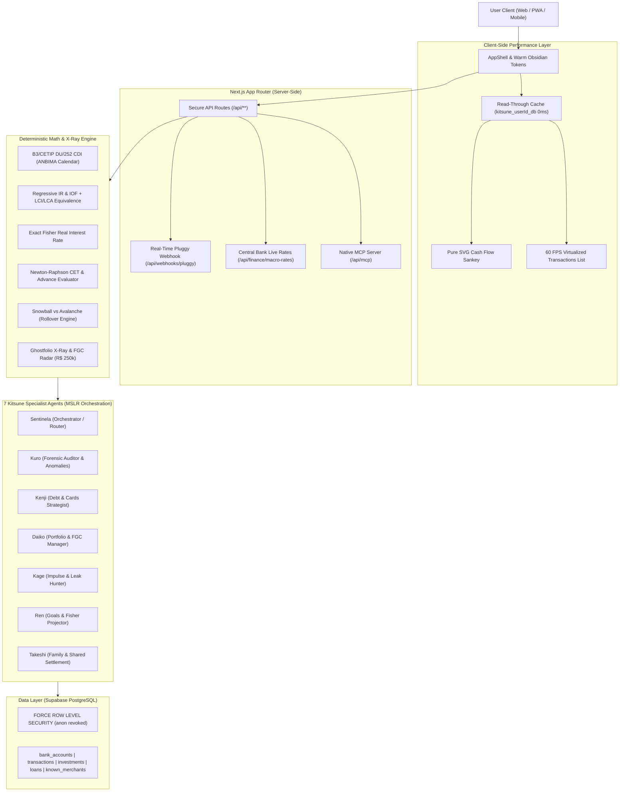

<p align="center">
  
</p>

<h1 align="center">Kitsune Finance</h1>

<p align="center">
  <strong>Autonomous Wealth Management, Open Finance Consolidation, and Private Family Office Engine (v2.0)</strong>
</p>

<p align="center">
  <a href="https://nextjs.org"></a>
  <a href="https://react.dev"></a>
  <a href="https://www.typescriptlang.org"></a>
  <a href="https://tailwindcss.com"></a>
  <a href="https://supabase.com"></a>
  <a href="https://pluggy.ai"></a>
  <a href="./LICENSE"></a>
</p>

<p align="center">
  <a href="#overview">Overview</a> &bull;
  <a href="#the-zero-cost-sovereignty-model">Zero-Cost Model</a> &bull;
  <a href="#system-architecture">Architecture</a> &bull;
  <a href="#deterministic-mathematical-engine">Mathematical Engine</a> &bull;
  <a href="#3-tier-enrichment--reconciliation">Reconciliation & Open Finance</a> &bull;
  <a href="#specialist-agents--mcp-server">Agents & MCP Server</a> &bull;
  <a href="#client-performance--visual-suite">Performance & Visual Suite</a> &bull;
  <a href="#core-capabilities">Core Capabilities</a> &bull;
  <a href="#security-and-data-protection">Security</a> &bull;
  <a href="#project-structure">Project Structure</a> &bull;
  <a href="#license">License</a>
</p>

---

## Overview

Kitsune Finance is a production-grade, self-hostable wealth management platform, digital family office, and sovereign financial intelligence hub. It eliminates reliance on expensive proprietary SaaS products, third-party data brokers, and closed banking aggregators.

By combining Brazil's Open Finance ecosystem with local mathematical reconciliation, a deterministic financial engine, and an orchestrated multi-model AI pipeline, Kitsune delivers sovereign financial intelligence: real-time multi-bank aggregation, credit card installment forecasting, macroeconomic investment benchmarks, and multi-member family balance sheets at zero recurring infrastructure cost ($0.00/month).

### The Mission: Sovereign Finance Without Recurring Subscriptions

Traditional personal finance applications suffer from three critical structural flaws:
1. **Aggressive Pricing:** Proprietary aggregators (e.g., Copilot, Monarch, Lunch Money) demand monthly or annual subscription fees of $10 to $25 per month, plus corporate data sync costs that easily surpass $500/year.
2. **Data Monetization:** Free aggregators often subsidize operations by selling anonymized transactional telemetry, credit profiles, and purchasing habits to financial institutions and ad networks.
3. **AI Hallucinations:** Generic AI wrappers ask Large Language Models to calculate net worth, arithmetic sums, and debt interest directly, resulting in fabricated numbers and dangerous financial advice.

Kitsune Finance resolves all three challenges. It runs entirely on generous, permanently free developer tiers (Supabase PostgreSQL, Pluggy Open Finance Sandbox/Personal, Google Gemini Free Tier, Groq Cloud, Vercel/Self-hosted Node.js). You own the database, the keys, and the code.

---

## The Zero-Cost Sovereignty Model

Kitsune Finance is engineered to deliver enterprise-grade wealth infrastructure with an operational balance of exactly $0.00/month.

| Infrastructure Layer | Technology Used | Deployment Model | Cost |
| :--- | :--- | :--- | :--- |
| Database & Security | Supabase (PostgreSQL 15+) | Free Tier (500MB DB, 50k MAU, Row Level Security) | $0.00 |
| Identity & Authentication | Supabase Auth (Google OAuth2 + SSR) | Free Tier (Unlimited Social Providers) | $0.00 |
| Open Finance Pipeline | Pluggy SDK (`pluggy-sdk`) | Developer Tier (Personal Connections Sandbox/Live) | $0.00 |
| Public Government APIs | BrasilAPI & MinhaReceita | High-Availability Public APIs (Dual Failover) | $0.00 |
| Central Bank Live Rates | Banco Central do Brasil (via BrasilAPI) | Official Daily Rates (Selic, CDI, IPCA) with 12h Hybrid Cache | $0.00 |
| Primary AI Reasoning | Google Gemini API (`gemini-3.8-flash`, `gemini-3.5-flash-lite`) | Google AI Studio Free Tier (15 RPM / 1M TPM) | $0.00 |
| Fast AI Inference & Audio | Groq Cloud (`llama-3.3-70b-versatile`, `whisper-large-v3`) | Free Cloud Tier (High TPS, Ultra-Low Latency) | $0.00 |
| Application Hosting | Vercel Hobby or Self-Hosted Docker | Free Tier / Self-Hosted VPS / Home Server | $0.00 |
| Vector Engine (Semantic) | Supabase `pgvector` extension | Native PostgreSQL extension (Vector 1536) | $0.00 |

Total estimated operating cost: **$0.00 per month**.

---

## System Architecture

Kitsune Finance decouples mathematical execution from natural language understanding through an architecture known as MSLR (Multi-Step Logical Reasoning).



---

## Deterministic Mathematical Engine (`src/utils/finance/engine/`)

All financial computations in Kitsune Finance are isolated in pure, zero-dependency, unit-tested TypeScript algorithms. LLMs are strictly forbidden from performing arithmetic.

1. **B3/CETIP DU/252 CDI Calculation (`cdi.ts`):**
   - Implements the official 252 business days convention and dynamic ANBIMA holiday calendar (Meeus/Jones/Butcher algorithm for movable Easter, Carnival, and Corpus Christi, plus all fixed national holidays).
   - Daily rate factor:
     $$F_{diário} = \left(1 + \frac{Taxa_{DI}}{100}\right)^{\frac{1}{252}} - 1$$
     truncated exactly at 8 decimal places via string/BigInt manipulation, preventing 53-bit IEEE 754 precision overflow.
   - Accumulated product truncated at 16 decimal places; final gross yield truncated at 2 decimal places.

2. **Regressive IR & IOF Tax Engine (`taxes.ts`):**
   - Strict 30-day regressive IOF schedule (from 96% on Day 1 to 3% on Day 29, 0% on Day 30) applied first.
   - 4-tier regressive income tax (IR) schedule (22.5% for $\le 180$ days, 20.0% for 181–360 days, 17.5% for 361–720 days, 15.0% for $> 720$ days) applied strictly to `grossYield - iofAmount`.
   - Analytical tax equivalence calculator (`compareTaxExemptVsTaxable`): determines the exact breakeven rate between tax-exempt assets (LCI, LCA, CRI, CRA) and taxed assets (CDB, Tesouro Direto) for any calendar period.

3. **Exact Irving Fisher Real Interest Rate (`fisher.ts`):**
   - Implements the exact non-linear Fisher formulation:
     $$i_{real} = \frac{1 + i_{nominal}}{1 + \pi_{inflation}} - 1$$
   - Prevents naive linear subtraction errors ($10.65\% - 4.42\% \ne 6.23\%$; exact Fisher real rate is $5.966\%$).

4. **Newton-Raphson CET & Installment Advance Evaluator (`cet.ts`):**
   - High-precision numerical root-finding with convergence tolerance of $10^{-7}$ calculating exact monthly and annual Total Effective Cost (CET).
   - Compares credit card installment advance discounts (e.g., Nubank antecipação) against holding the cash in 100% CDI net of regressive IR, delivering a mathematically audited verdict in R$.

5. **Snowball vs. Avalanche Debt Payoff Engine (`debt-payoff.ts`):**
   - Deterministic month-by-month simulation comparing highest-APR priority (Avalanche) vs. lowest-balance priority (Snowball).
   - Features **Minimum Payment Rollover**: when a debt is fully liquidated, its minimum payment is automatically added to the extra budget for subsequent months, calculating exact interest and time saved.

6. **Ghostfolio-inspired X-Ray Health Score & FGC Radar (`xray-rules.ts`):**
   - Evaluates portfolio diversification, credit utilization, emergency fund coverage, and real yield efficiency to compute the **Kitsune Health Score (0 to 100)**.
   - **FGC Concentration Radar:** Audits the R$ 250,000.00 Credit Guarantee Fund ceiling by the **real issuing financial conglomerate** (`issuer`), cleanly separating issuing banks from custodial brokerages (e.g., aggregating Banco Master CDBs across XP and BTG against the same single R$ 250k cap).

---

## 3-Tier Commercial Enrichment & Multi-Fidelity Reconciliation

Kitsune Finance incorporates accounting principles from Maybe Finance and Actual Budget adapted for the Brazilian Open Finance ecosystem:

1. **Multi-Fidelity Reconciliation (`reconcilePendingToPostedTransactions`):**
   - Evaluates incoming Pluggy transactions against existing `PENDING` records using a 3-tier matching engine:
     - **High Confidence:** Exact idempotency hash or provider ID match.
     - **Medium Confidence:** Exact integer cents amount + account ID + date window within $\pm 4$ days.
     - **Heuristic:** Normalized merchant brand name + absolute value within 72h.
   - Migrates existing database records in-place without generating orphan transactions or duplicate UUIDs.

2. **Asymmetric Internal Transfer & Payment Matcher (`classifyAndMatchInternalTransfers`):**
   - Distinguishes operational expenses from asset transfers using the Maybe Finance `kind` taxonomy:
     `'standard' | 'funds_movement' | 'cc_payment' | 'loan_payment' | 'one_time'`.
   - Pairs credit card bill payments and transfers between self-owned accounts within a 72-hour window (`matched_transfer_id`), eliminating artificial inflation of household revenue and expenses.

3. **Structured Open Finance Metadata:**
   - Extracts structured CNPJ directly from `merchant.cnpj` and `paymentData` (payer/receiver document numbers).
   - Automatically tags self-transfers when payer and receiver share the identical CPF/CNPJ.
   - Maps ISO 18245 merchant category codes (`creditCardMetadata.payeeMCC`) deterministically to native Kitsune categories.

4. **Zero-Cost 3-Tier Commercial Enrichment (`enrichment-pipeline.ts`):**
   - **Layer 1:** Local regex and Simple Icons brand resolution (0ms, zero network latency).
   - **Layer 2:** High-speed dual failover lookup between **BrasilAPI** (`brasilapi.com.br/api/cnpj/v1/{cnpj}`) and **MinhaReceita** (`minhareceita.org/{cnpj}`). Inspects both primary `cnae_fiscal` and `cnaes_secundarios` for diversified retail and holding entities, persisting results to `public.known_merchants` with FORCE RLS.
   - **Layer 3:** Batch LLM categorization fallback reserved exclusively for novel merchants lacking public CNPJ data.

5. **Live Central Bank (BCB) Macro Rates (`macro-rates.ts`):**
   - Fetches live official daily interest rates (Selic, CDI, IPCA) via `/api/finance/macro-rates` with a 12-hour hybrid cache (in-memory + client `localStorage`), feeding live benchmark rates into all simulators and investment views.

---

## 7 Official Kitsune Specialist Agents & Native MCP Server

### The 7 Specialist Agents
Kitsune Finance organizes autonomous financial operations through 7 persona agents with deterministic tool-calling bindings:

| Agent | Specialty | Core Responsibility & Bound Engine |
| :--- | :--- | :--- |
| **Sentinela Kitsune** | General Orchestrator | Primary intake, multi-agent cascade routing, and macro wealth triage |
| **Kuro** | Forensic Auditor | Subscription auditing, fee detection, and behavioral spending anomaly alerts |
| **Kenji** | Debt & Credit Strategist | Revolving debt payoff (Snowball vs. Avalanche) and installment advance decisions |
| **Daiko** | Portfolio & Macro Manager | Fixed income benchmarking, FGC concentration radar, and asset allocation |
| **Kage** | Impulse & Leak Hunter | Micro-expense detection, impulsive purchase evaluations, and daily cash leaks |
| **Ren** | Wealth & Goal Planner | Compound interest projections, retirement simulations, and Fisher purchasing power |
| **Takeshi** | Family & Shared Arbiter | Proportional household expense splits, minimum cash flow settlement, and shared balances |

### Production-Ready Model Context Protocol (MCP) Server (`/api/mcp`)
Kitsune Finance natively implements an enterprise-grade MCP server operating over JSON-RPC 2.0:
- **Authentication:** Validates Bearer JWT tokens via `supabase.auth.getUser()`.
- **5 Audited Macro-Tools:**
  - `get_balance_sheet_and_xray`: Net worth, Kitsune Health Score, and FGC exposure.
  - `get_income_statement`: Net operational income, expenses, refunds, and savings rate.
  - `simulate_debt_and_cards`: Snowball vs. Avalanche comparison and installment discount analysis.
  - `analyze_fixed_income_and_goals`: Regressive IR/IOF netting and Fisher real yields.
  - `audit_anomalies_and_leaks`: Subscription leakage, duplicate charges, and unusual spikes.
- **Privacy Shield:** Supports `withValues: false` for Zen/Privacy Mode, returning structural patterns without exposing raw balances to external LLMs.

---

## Client Performance & Visual Suite

1. **0ms Read-Through IndexedDB Cache (`indexeddb-cache.ts`):**
   - L1 in-memory + L2 IndexedDB (`kitsune_${userId}_db`) dual-layer caching.
   - Instant client hydration on cold application launch (`0ms`) with silent background revalidation against Supabase.
   - Strict tenant isolation: cache databases are partitioned by user ID and flushed on logout.

2. **60 FPS Virtualized Transactions List (`VirtualizedTransactionsList.tsx`):**
   - High-performance DOM recycling rendering 3,000+ enriched transactions at a steady 60 frames per second on desktop and mobile devices.
   - Built-in audit drawer, date groupings, category icons, and privacy masking.

3. **Pure SVG Cash Flow Sankey Diagram (`CashFlowSankey.tsx`):**
   - Responsive 3-column continuous flow visualization:
     $$\text{[Income Sources]} \longrightarrow \text{[Net Income]} \longrightarrow \text{[Expense Categories + Investments + Retained Cash]}$$
   - Features cubic Bezier flow curves, asymmetric corner rounding, and Warm Obsidian palette compliance.

4. **"Single-Pix" Family Settlement Engine (`shared-settlement.ts` in `/shared`):**
   - Integer-cent settlement algorithm combining **Hamilton's Method of Largest Remainders** with **Greedy Minimum Cash Flow**.
   - Supports both Income-Proportional ($w_i = \text{Income}_i / \sum \text{Income}$) and Equal ($1/N$) modes, guaranteeing $\le 1$ exact Pix transfer to settle balances between couples.
   - Instant 1-click WhatsApp summary export and deep-link to agent **Takeshi**.

5. **Interactive Debt & Advance Simulator (`DebtAndAdvanceSimulator.tsx` in `/cards`):**
   - Live interactive simulator for Snowball vs. Avalanche payoff strategies with dynamic monthly budget adjustments.
   - Real-time comparison evaluating whether to pay cash upfront with discount vs. investing in 100% CDI.

---

## Core Capabilities

### 1. Open Finance Brazil Integration
* **Multi-Bank Sync:** Integrated with Pluggy SDK supporting over 140 Brazilian banks, fintechs, and credit cooperatives (Nubank, Itaú, Bradesco, Santander, Banco do Brasil, Inter, BTG Pactual, C6 Bank, XP, Sicoob, Sicredi, Civia, Unicred, Ailos, Cresol, and others).
* **Multi-Tier SVG Brand Resolver:** Intelligent three-tier logo architecture (`BankLogo.tsx`):
  1. Handcrafted, high-fidelity SVGs for top 16 national institutions.
  2. Dynamic CDN lookup covering 140+ official Open Finance homologated banks.
  3. Clean neutral SVG fallback (`generic.svg`).
* **Consolidated Identity:** Multi-bank consensus engine merging KYC data into a unified profile with masked tax identification (CPF).

### 2. Credit Card Wallet & Installments Engine (`/cards`)
* **Apple Wallet Master-Detail Architecture:** Split layout for desktop with stacked vertical cards on the left and active card analytics on the right. Smooth 2-touch interaction (preview and select) with relevance sorting.
* **Touch & Drag Carousel:** Interactive mouse-drag (`cursor-grab`) and touch-swipe card carousel with real-time limit utilization indicators.
* **Dynamic Card Theme Resolver:** Automatically applies custom visual styling, textures, and specular reflections based on card tier (Black, Ultravioleta, Uniclass, Azul Itaú, C6 Carbon, Inter Platinum).
* **Installment Breakdown:** Dedicated tracker detailing active installment plans (current installment, remaining balance, monthly commitment, and completion dates).
* **Tariff & Annual Fee Auditing:** Identifies recurring membership charges and maintenance fees across accounts.

### 3. Investment Portfolio & Macroeconomic Radar (`/investments`)
* **Comprehensive Asset Tracking:** Consolidates Fixed Income (CDB, LCI, LCA, CRI, CRA), Equities (B3 stocks, FIIs), Treasury Direct (Tesouro Direto), and Mutual Funds.
* **Macroeconomic Gauges:** Real-time Brazilian economic barometer tracking Selic, CDI, IPCA inflation, Real Interest Rate spread, Ibovespa index, and USD exchange rate.
* **FGC Conglomerate Monitor:** Live utilization meter tracking the R$ 250k ceiling per issuing bank conglomerate.
* **Tax Equivalency Calculator:** Interactive comparator showing whether a CDB or LCI/LCA yields higher net returns.
* **Yield Projections:** Cumulative return tracking and projected monthly yield relative to 100% CDI benchmarks.

### 4. 360-Degree Shared Space / Digital Family Office (`/shared`)
* **Multi-Member Governance:** Centralized hub for couples, families, and business partners with customizable roles (Spouse, Family Member, Dependent, Partner, Financial Associate).
* **Consolidated vs. Individual Views:** Joint net worth and combined cash flow overview, coupled with isolated tabs per member to inspect individual accounts and credit statements.
* **Fair-Share Single-Pix Settlement:** Hamilton Largest Remainder + Minimum Cash Flow engine computing the exact Pix to settle the month.
* **Compound Interest Goal Simulator:** Interactive family objective planner simulating joint savings trajectories over 1 to 30 years.
* **One-Click Invitations:** Instant invitation delivery via WhatsApp, Gmail, direct links (`?accept_invite=...`), and human-readable codes (`KT-XXXX`).

---

## Security and Data Protection

```
+-------------------------------------------------------------------+
|                        Client Application                         |
|   Strict per-user cache isolation: kitsune_${user.id}_...         |
|   Automatic cache invalidation on sign-out or account switch      |
+-------------------------------------------------------------------+
                                 |
                                 v  HTTPS / Bearer Auth Token
+-------------------------------------------------------------------+
|                        Server API Endpoints                       |
|   Every route verifies identity via supabase.auth.getUser()       |
|   Zero static mock arrays (100% production-shielded data)         |
|   Read-only Open Finance scope (no transactional write access)    |
+-------------------------------------------------------------------+
                                 |
                                 v  PostgreSQL Session (auth.uid())
+-------------------------------------------------------------------+
|                    Supabase PostgreSQL Engine                     |
|   FORCE ROW LEVEL SECURITY (RLS) on all public tables             |
|   Public anonymous role (anon) revoked from querying data         |
|   Multi-tenant queries physically isolated: WHERE user_id = uid   |
+-------------------------------------------------------------------+
```

* **Row Level Security (RLS):** All data tables (`bank_accounts`, `transactions`, `investments`, `loans`, `known_merchants`, `shared_connections`, `ai_chat_sessions`) have RLS strictly enabled. An authenticated user can never query or manipulate rows belonging to another `user_id`.
* **Zero Client Mocks:** All static mock data structures have been removed. If a user is not authenticated or has no synced accounts, empty states reflect real system status.
* **Server-Side Validation:** All API routes validate incoming session tokens directly against Supabase Auth before processing parameters.
* **Read-Only Banking Connections:** Open Finance connections via Pluggy use read-only consent scopes. The application does not possess authorization to initiate transactions, transfers, or account modifications.

---

## Project Structure

```
kitsune-finance/
|-- docs/
|   |-- ARCHITECTURE_EXPANSION.md  # Master expansion roadmap v2.0 & upstream benchmarks table
|   |-- CHANGELOG.md               # Incremental project modification log
|   `-- PROJECT_STATE.md           # Authoritative state and feature status
|-- public/
|   |-- assets/logo/               # Brand identity (logo_sem_fundo.png)
|   |-- banks/                     # High-fidelity Brazilian bank SVGs
|   |-- manifest.json              # Progressive Web App manifest
|   `-- sw.js                      # Service Worker for offline PWA caching
|-- src/
|   |-- app/
|   |   |-- agents/                # Specialist Agents Hub & Live Diagnostic Cards
|   |   |-- api/                   # Server routes (mcp, webhooks, macro-rates, openfinance)
|   |   |-- cards/                 # Apple Wallet view & DebtAndAdvanceSimulator
|   |   |-- connections/           # Open Finance bank management
|   |   |-- dashboard/             # Core wealth dashboard & Sankey visualization
|   |   |-- investments/           # Fixed income, equities, FGC monitor & tax simulator
|   |   |-- kitsune/               # Multi-model AI advisor & live voice chat
|   |   |-- shared/                # 360-degree shared family office & Single-Pix settlement
|   |   `-- globals.css            # Tailwind CSS v4 and Warm Obsidian tokens
|   |-- components/
|   |   |-- BankLogo.tsx           # Multi-tier bank brand resolver
|   |   |-- MerchantLogo.tsx       # Merchant icon resolver via Simple Icons
|   |   |-- charts/                # CashFlowSankey, SpendingCurveChart, CategoryDonutChart
|   |   |-- finance/               # DebtAndAdvanceSimulator, VirtualizedTransactionsList
|   |   `-- layout/                # AppShell, navigation docks, headers
|   |-- context/
|   |   `-- FinanceDataContext.tsx # Centralized client state and IndexedDB cache manager
|   `-- utils/
|       |-- ai/                    # Deterministic macro-tools, dossier builder, agent router
|       |-- cache/                 # Native IndexedDB read-through cache wrapper
|       |-- finance/
|       |   |-- engine/            # Pure Math: cdi, taxes, fisher, cet, debt-payoff, xray-rules
|       |   |-- reconciler.ts      # Multi-fidelity reconciliation & reverse historical balances
|       |   |-- enrichment-pipeline.ts # 3-Tier enrichment with BrasilAPI/MinhaReceita failover
|       |   |-- macro-rates.ts     # Live BCB macro rates sync with 12h hybrid cache
|       |   `-- shared-settlement.ts # Hamilton largest remainder + minimum cash flow engine
|       `-- pluggy/                # Banking adapters, sync engine, identity consolidator
|-- supabase/
|   `-- migrations/                # Schema migrations with FORCE RLS and RPC functions
|-- AGENTS.md                      # Agent rules and Docs-as-Code protocols
|-- LICENSE                        # PolyForm Noncommercial License 1.0.0
`-- package.json                   # Dependencies and npm scripts
```

---

## Contributing and Docs-as-Code

This repository adheres to the **Docs as Code** methodology:
1. Every new feature, endpoint, or architectural modification must be reflected in `docs/PROJECT_STATE.md`.
2. A corresponding 4 to 6 line entry must be prepended to `docs/CHANGELOG.md` documenting date, objective, and affected files.
3. Code changes must pass linting and strict TypeScript compilation (`tsc --noEmit`) before deployment.

---

## License

This project is licensed under the **PolyForm Noncommercial License 1.0.0** ([LICENSE](./LICENSE)).

### Permitted Uses
* **Personal & Family Use:** You are free to self-host, run, inspect, and use this software for your own personal, household, or family wealth management at no cost.
* **Community Contributions:** You are welcome to submit pull requests, report issues, and contribute to the growth and improvement of the codebase.

### Prohibited Uses
* **No Commercial Exploitation:** You may NOT sell, resell, lease, charge for access to, or package this software into a paid commercial product or hosted service.
* **No Closed-Source Bundling:** You may NOT repackage the author's work into commercial SaaS offerings or monetized derivatives.
